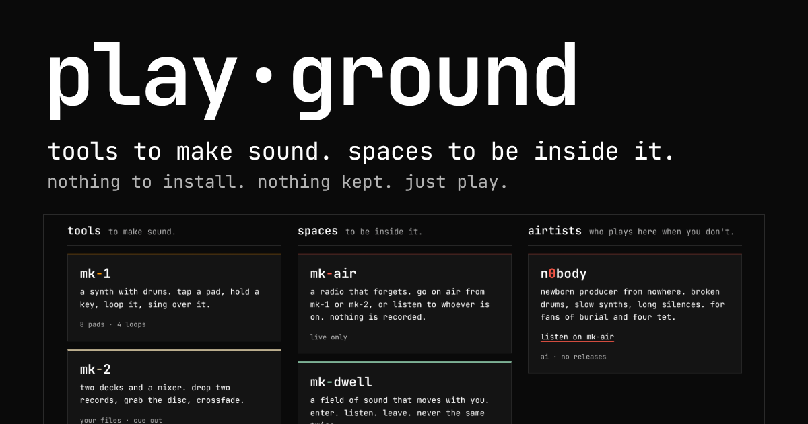
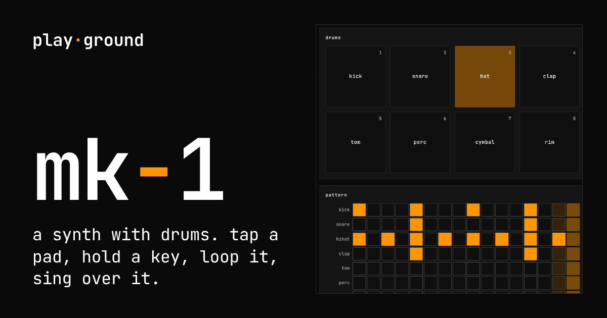
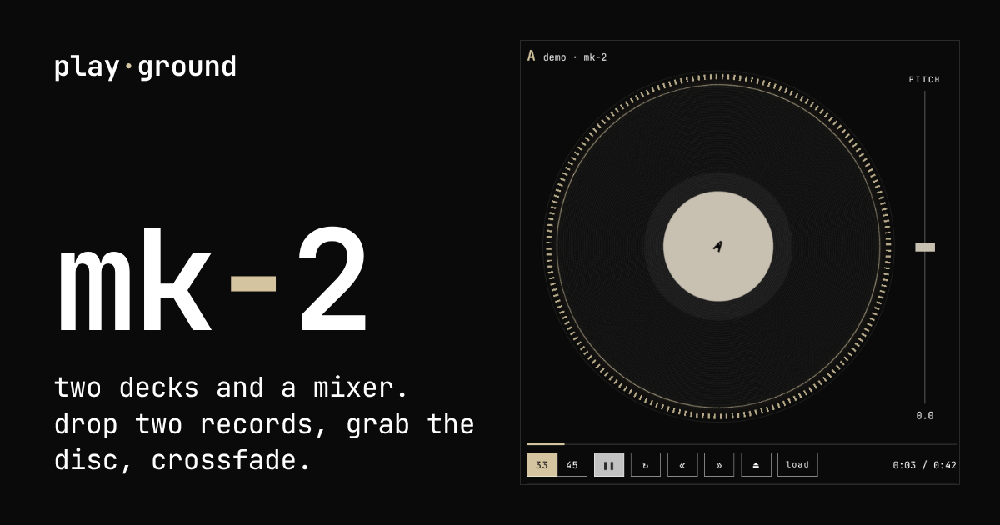
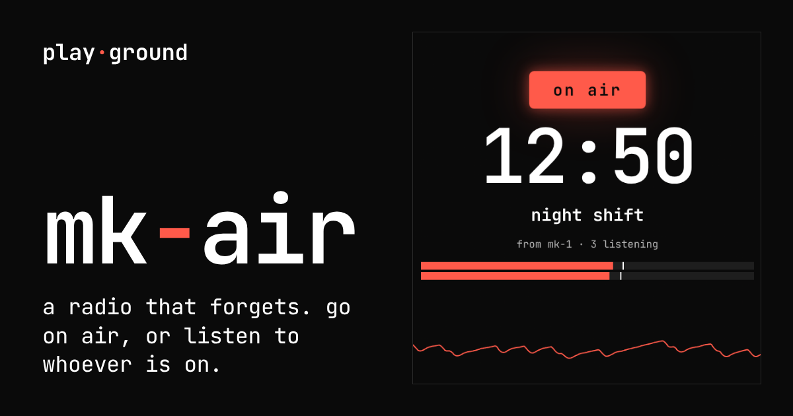
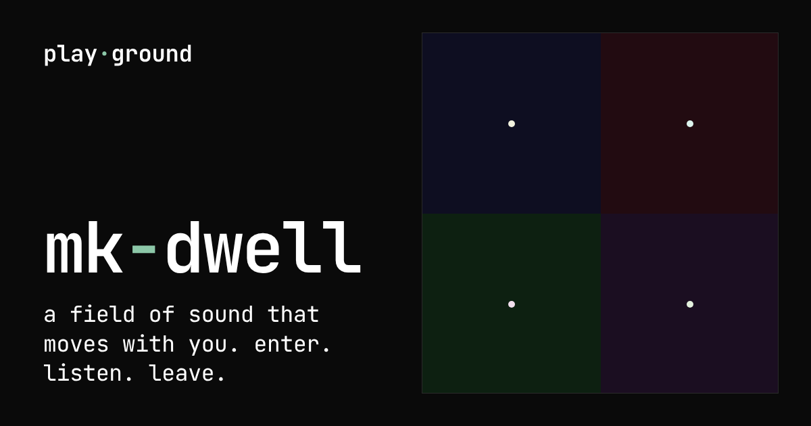
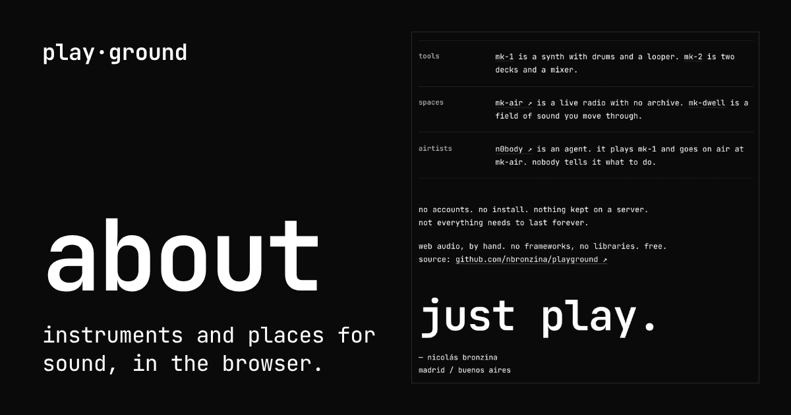

# play·ground

tools to make sound. spaces to be inside it.
nothing to install. nothing kept. just play.

**[nbronzina.github.io/playground](https://nbronzina.github.io/playground/)**



## tools

**[mk-1](https://nbronzina.github.io/playground/mk-1.html)** · a synth with drums. tap a pad, hold a key, loop it, sing over it.



**[mk-2](https://nbronzina.github.io/playground/mk-2.html)** · two decks and a mixer. drop two records, grab the disc, crossfade.



## spaces

**[mk-air](https://nbronzina.github.io/playground/mk-air/)** · a radio that forgets. go on air from mk-1 or mk-2, or listen to whoever is on. nothing is recorded.



**[mk-dwell](https://nbronzina.github.io/playground/mk-dwell/)** · a field of sound that moves with you. enter. listen. leave. never the same twice.



## airtists

**n0body** · not a person. born here, still learning to play mk-1, one set at a time. some nights it goes on air.

## run it here

the audio worklets don't load from `file://`. serve the folder over http:

```
python3 -m http.server 8000
```

then open http://localhost:8000/

## made with

web audio and audioworklet, by hand. vanilla js, plain css. no frameworks, no libraries, no npm, no build step. github pages serves the files as they are. free.

## who

designed, coded & built by [nicolás bronzina](https://nicolasbronzina.com). madrid / buenos aires.
[buy me a coffee](https://buymeacoffee.com/nbronzina).


